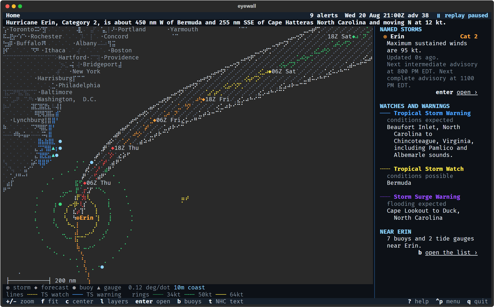

# eyewall

eyewall is a terminal app that tracks tropical cyclones in the Atlantic, East Pacific and Central Pacific. It reads free
NOAA feeds, needs no account or key, and describes each storm, its watches and warnings, and the buoys and tide gauges
near it in plain words.



eyewall is not an official forecast or warning. For decisions about life or property, follow the National Hurricane
Center and your local emergency officials.

## Prerequisites

- A terminal that draws Unicode, such as Windows Terminal, iTerm2, kitty or GNOME Terminal, at least 60 columns by 16
  rows. Use 100x30 or larger to see the column of storm cards beside the map.
- Windows 11, Linux with glibc 2.31 or newer, or macOS. Alpine and other musl systems are not supported. The macOS
  binaries need macOS 14 on Apple silicon and macOS 15 on Intel. The pip routes below work on older versions.
- For the PyPI routes, Python 3.12 or newer. The git routes also need `git`. The standalone binaries need none of these.
- Network access to NOAA for live data. `--demo` works offline.

## Quickstart

Install from [PyPI](https://pypi.org/project/eyewall/) with any one of these commands:

```
pipx install eyewall
uv tool install eyewall
python -m pip install eyewall
```

To try the development version instead, install from the default branch. This needs `git`:

```
pipx install git+https://github.com/WPTK/eyewall
uv tool install git+https://github.com/WPTK/eyewall
python -m pip install git+https://github.com/WPTK/eyewall
```

If you prefer a standalone binary, download the file for your platform from the
[releases page](https://github.com/WPTK/eyewall/releases). `docs/install.md` lists the file names, the checksums and
the first-run warnings on Windows and macOS.

Then run it:

```
eyewall --selftest     # check the installation; prints "selftest ok"
eyewall --demo         # replay Hurricane Erin (August 2025); works offline
eyewall                # live data
```

If no storm is active when you run `eyewall`, it says so, and `R` starts the same Erin replay. In the demo, press
`Enter` on the storm, then `t` for the NHC text and `b` for the buoys. To work on eyewall itself, read
`docs/development.md`.

## Configuration

eyewall runs without a config file. To change a default, pass a flag or write `config.toml` in your user config
directory. The first save from the settings screen (`S`, then `Ctrl+S`) creates the file. It lives at
`%LOCALAPPDATA%\eyewall\config.toml` on Windows, `~/.config/eyewall/config.toml` on Linux (`$XDG_CONFIG_HOME` applies)
and `~/Library/Application Support/eyewall/config.toml` on macOS. Flags override the file and are never saved.
`docs/configuration.md` lists every key.

| Variable or flag | Default | Description |
| --- | --- | --- |
| `--config PATH` | the user config file | Read this settings file instead. |
| `--no-config` | off | Ignore the settings file and use the built-in defaults. |
| `--basin {AL,EP,CP}` | all three | Show one basin. Repeat the flag for more. |
| `--glyphs {unicode,ascii}` | `unicode`, or `ascii` on a terminal that cannot draw braille | Symbol set for the map. |
| `--state-dir DIR` | the user data directory | Where eyewall keeps the set of alerts it has shown. |
| `NO_COLOR` | unset | Set it to draw without color. Every color cue also has a word, glyph or line pattern. |
| `HTTPS_PROXY`, `HTTP_PROXY`, `ALL_PROXY`, `NO_PROXY` | unset | Route NOAA requests through a proxy. |
| `[poll]` | 5 to 30 minutes per feed | File only. Seconds between polls; the defaults are also the shortest allowed. |
| `[units] preset` | `nautical` | `nautical`, `us` or `metric`. The `u` key cycles them. |
| `[watchlist]` | three buoys, one tide gauge | Stations that always show, storm or no storm. |
| `[alerts]` | all on except `bell` | Which events raise an alert. |

## Usage and controls

```
eyewall                           # live data
eyewall --demo                    # the bundled Erin recording
eyewall --replay DIR              # a recording of your own
eyewall --basin AL                # only the Atlantic; repeat the flag for EP and CP
eyewall --glyphs ascii            # plain symbols for terminals that cannot draw braille
eyewall --summary                 # print the situation in plain sentences, then exit
eyewall --headless --until +12h   # no interface; print events as they happen
eyewall --diagnose                # versions, terminal abilities, file paths and feed reachability
```

`--summary` exits 0 on success, 1 if any feed failed (stderr names it) and 2 for a bad argument or an unreadable
replay. `eyewall --help` lists every flag.

You can click a storm, a buoy, a card or a footer key, and drag the map to pan it. The footer shows the keys that work
on the current screen.

| Key | What it does |
| --- | --- |
| `?` | Help: every key |
| `Ctrl+P` | The menu: every screen, action, storm and station |
| `Enter` | Open the selected storm, buoy or gauge |
| `t`, `b`, `g` | NHC text, buoys and gauges, pictures |
| `1`, `2`, `3`, `a` | Atlantic, East Pacific, Central Pacific, all enabled basins |
| `+`, `-`, arrow keys | Zoom and pan the map |
| `r` | Refresh every feed now |
| `D`, `A` | Feed health, alert log |
| `Esc` | Go back |
| `q` | Quit, from the first screen only |

`docs/usage.md` describes each screen and lists every key. `docs/replay.md` explains replays and how to record another
storm. `docs/data-sources.md` lists the NOAA feeds.

## License

MIT. The map outlines come from Natural Earth, which is in the public domain.
