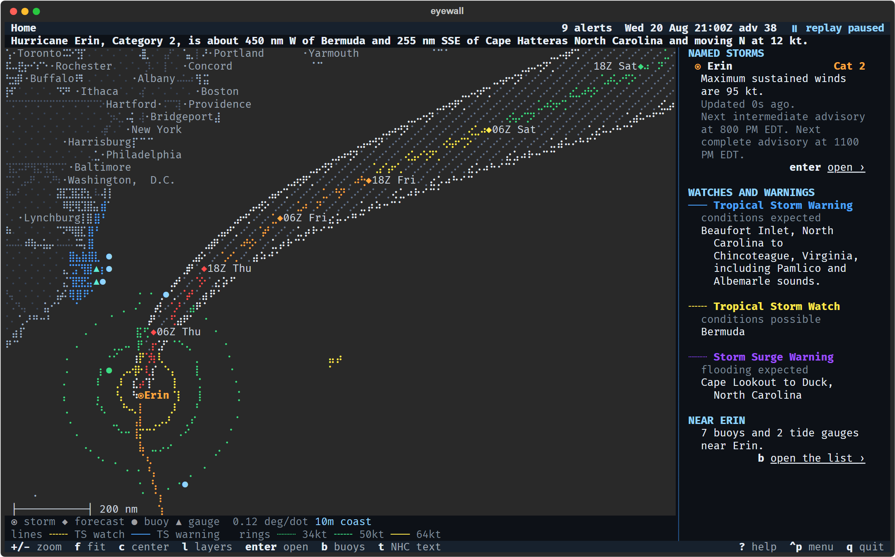
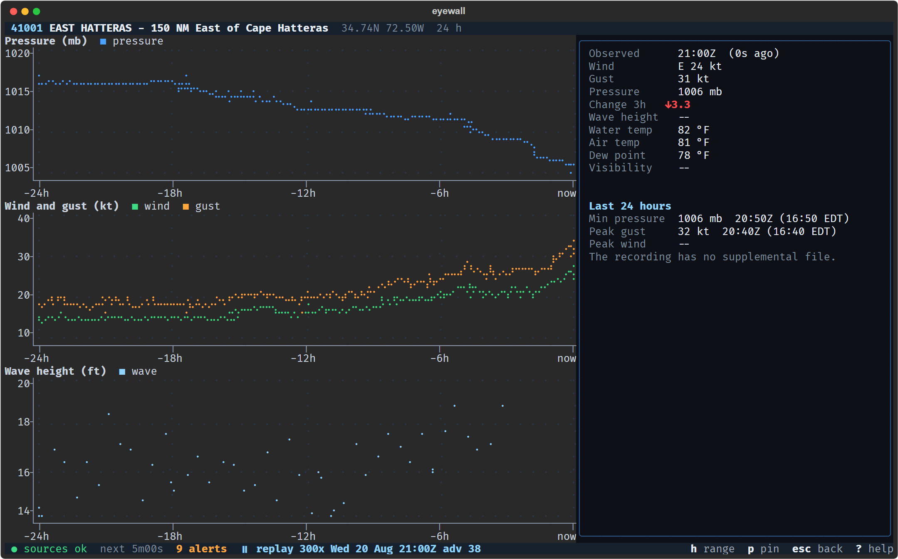

# eyewall

eyewall is a terminal app that tracks tropical cyclones in the Atlantic, East Pacific and Central Pacific. It reads free
NOAA feeds, so it needs no account or key, and it shows the buoys and tide gauges near each storm next to the forecast.



For each active storm you get the National Hurricane Center advisory and discussion, the forecast track and cone,
watches and warnings, wind radii and NOAA's graphics. For the buoys and tide gauges along the storm's path you get the
latest readings with pressure, wind and wave charts. When NOAA posts something new, eyewall tells you. With no storm
active it shows the tropical weather outlook and a watchlist of stations you pick.

eyewall is not an official forecast or warning. For decisions about life or property, follow the National Hurricane
Center and your local emergency officials.

## Try it without a storm

Most of the year nothing is active, so eyewall ships with a recording of Hurricane Erin (August 2025):

```
eyewall --demo
```

A buoy's charts from the same recording:



## Install

Standalone binaries for Windows, Linux (x86_64 and arm64) and macOS (Apple silicon and Intel) are on the
[releases page](https://github.com/WPTK/eyewall/releases). They need no Python and are not signed, so Windows and macOS
may warn on first run; `docs/install.md` covers that and the checksums.

With Python 3.12 or newer you can install from the repository:

```
pipx install git+https://github.com/WPTK/eyewall
```

Or from a clone:

```
python -m venv .venv
.venv/bin/python -m pip install -e .        # Windows: .venv\Scripts\python
.venv/bin/python -m eyewall --demo
```

`eyewall --selftest` checks an installation: it replays an hour of the bundled storm and prints `selftest ok`.

## Use

```
eyewall                           # live data
eyewall --demo                    # the bundled Erin recording
eyewall --replay DIR              # a recording of your own
eyewall --basin AL                # only the Atlantic; repeat the flag for EP and CP
eyewall --glyphs ascii            # plain symbols for terminals that cannot draw braille
eyewall --headless --until +12h   # no interface; print events as they happen
```

Other flags: `--config PATH` and `--no-config` for the settings file, `--state-dir DIR` for where seen events are kept,
`--version`, and `--help` for the full list.

Keys: `Enter` opens the selected storm's detail and `Esc` goes back. `g` shows graphics, `O` the tropical weather
outlook, `w` the watchlist, `/` finds a station, `A` the alert log, `u` changes units, `r` refreshes, `S` opens the
settings, `?` lists every key and `q` quits. In a replay, `Space` pauses, `<` and `>` change the speed, and `[` and `]`
step between advisories.

Use a terminal that draws Unicode, such as Windows Terminal, iTerm2, kitty or GNOME Terminal. Inline images need Sixel
or the Kitty graphics protocol; elsewhere eyewall draws an approximation. `docs/replay.md` explains replays and how to
record another storm.

## Data sources

Everything comes from public NOAA services:

- NHC and CPHC: advisories, forecast discussions, GIS products and storm graphics
- NWS: watches, warnings and other alerts
- NDBC: buoy observations
- CO-OPS: tide gauge water levels
- NESDIS: satellite imagery

None of them needs a key. eyewall identifies itself with a User-Agent, makes conditional requests and polls no faster
than each feed allows. `docs/data-sources.md` lists the feeds, their formats and the polling cadence. A weekly workflow
checks that each feed still parses.

## Documentation

- `docs/install.md`: binaries, pipx, settings and the config file
- `docs/replay.md`: replaying and recording storms
- `docs/data-sources.md`: the NOAA feeds
- `docs/development.md`: setup, checks, tests and releases

Bugs and ideas go in the [issues](https://github.com/WPTK/eyewall/issues).

## License

MIT. The map outlines come from Natural Earth, which is in the public domain.
