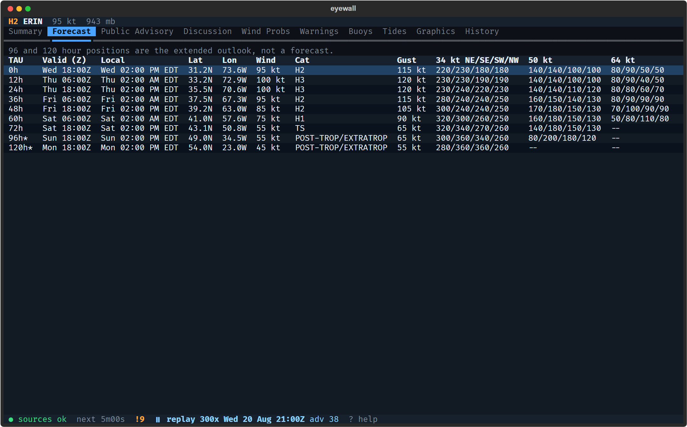

# eyewall

A terminal app that tracks tropical cyclones with free NOAA data and shows the buoys and tide gauges near each storm.


eyewall follows storms in the Atlantic, East Pacific and Central Pacific. For each one it shows the National Hurricane
Center advisory and discussion, the forecast track and cone, watches and warnings, wind radii and probabilities, and
NOAA's graphics. It pairs that with live readings from National Data Buoy Center buoys and CO-OPS tide gauges near the
storm's path, with pressure, wind and wave charts, and it alerts you when NOAA posts something new. Between storms it
shows the tropical weather outlook and a watchlist of buoys you choose.

eyewall is not an official source of warnings. For decisions about life and property, use the National Hurricane Center
and your local National Weather Service office.

## Try it

Most of the year nothing is active, so eyewall carries a recording of Hurricane Erin (2025):

```
eyewall --demo
```

| Forecast table | A buoy's charts |
|---|---|
|  |  |

`?` lists every key. `docs/replay.md` explains replay and how to record another storm.

## Install

Download a standalone binary for Windows, Linux or macOS from the
[releases page](https://github.com/WPTK/eyewall/releases), or install with `pipx` or `uv` (Python 3.12 or newer).
`docs/install.md` has the details, and `docs/smoke-test.md` is the checklist used before each release.

From a clone:

```bash
python -m venv .venv
.venv/bin/python -m pip install -e ".[dev]"      # Windows: .venv\Scripts\python
.venv/bin/python -m eyewall --demo
```

## Data

Everything comes from public NOAA feeds that need no key: NHC and CPHC advisories and GIS products, NWS alerts, NDBC
buoys, CO-OPS tide gauges and NESDIS satellite imagery. The feeds, their formats and how often eyewall polls them are in
`docs/data-sources.md`. A weekly workflow checks that each feed still parses.

## Status

Version 0.8.0. All eight milestones are done; `docs/plan.md` has the design and `docs/milestones/` what each release
added.

| Milestone | Release | Status |
|---|---|---|
| M1 NHC data layer | 0.1.0 | done |
| M2 Observations data layer | 0.2.0 | done |
| M3 Renderer and basemap | 0.3.0 | done |
| M4 Core: sources, store, poller, replay | 0.4.0 | done |
| M5 Storm UI | 0.5.0 | done |
| M6 Observations UI | 0.6.0 | done |
| M7 Graphics | 0.7.0 | done |
| M8 Polish and release | 0.8.0 | done |

Open work is tracked in the [issues](https://github.com/WPTK/eyewall/issues).

## Contributing

`CLAUDE.md` holds the working rules. Run the checks listed in `docs/development.md` before opening a pull request.

## License

MIT. Map outlines come from Natural Earth, which is in the public domain.
