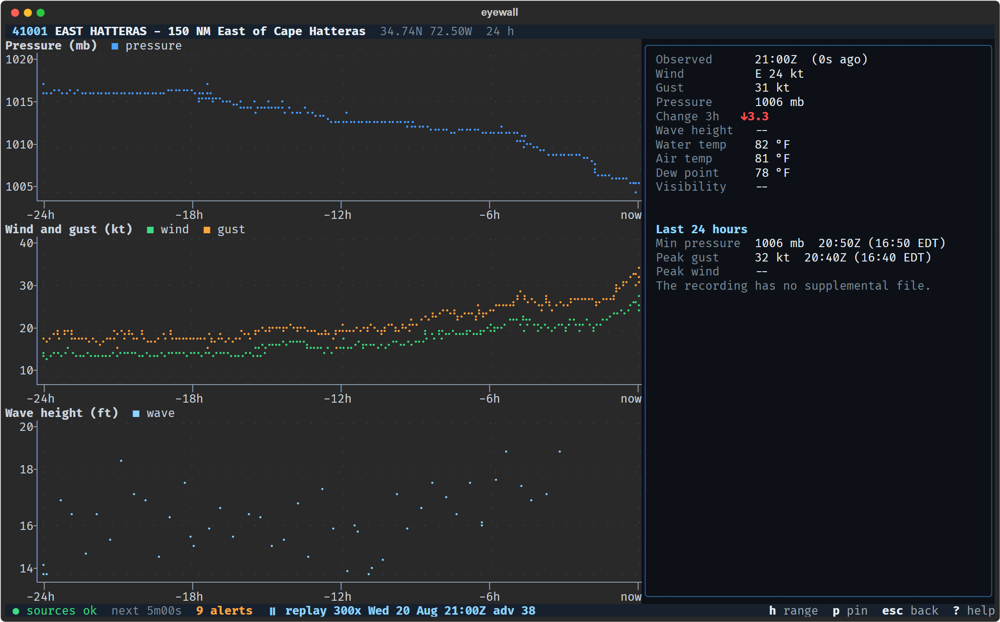

# Usage

## Screens

The map is the first screen at every terminal size. It draws each active storm with its forecast cone, track, wind rings
and the watches and warnings along the coast. Beside the map (under it on a small terminal) you get a card for each named
storm, the watches and warnings in the National Hurricane Center's own words, what NHC is watching in the outlook, and
the stations near the storm. With no storm active, the map says so in a sentence, shows the outlook areas and your own
stations, and offers a replay of Hurricane Erin.

At 80x24 the map fills the screen with a line about the storm and a line of warnings under it. At 100x30 or larger the
column of cards appears beside the map. Below 60x16 eyewall shows the size it needs instead of a broken screen.



Six more screens open from the map. `Esc` goes back from each.

- Storm (`Enter` on a storm) shows a lead sentence, the watches and warnings and what they mean, wind, size, the
  forecast, the chance of strong wind, when the next advisory is due and how old the data is.
- NHC text (`t`) shows the public advisory, discussion, forecast/advisory, wind chances, outlook and past track, with the
  issue time, the advisory number and a banner when the text is out of date.
- Buoys and gauges (`b`) has two tabs: the stations near the storm and the stations you follow. Sort by distance, wind or
  name, and follow the ones you care about.
- Station (open a buoy or tide gauge) shows a plain sentence, trends, pressure, wind and wave charts over 24, 48 or 72
  hours, and a table of readings.
- Pictures (`g`) shows NOAA's cone and satellite pictures for the storm, with loops. In `--demo` the list starts empty.
  The recording holds two cone stills, which appear once the replay passes advisory 33. It holds no satellite pictures.
- Help (`?`) lists every key and explains what the top bar says about the health of the feeds.

## Mouse and keyboard

You can click a storm, a buoy or tide gauge on the map (a chooser opens when marks overlap), a card's `open >` link, a
row in a list, the breadcrumb in the top bar, any key in the footer and the feed-health slot. Drag the map to pan it.
`Ctrl+P` opens a menu of every screen, action, storm and station. Type part of a name to find it.

| Key | What it does |
| --- | --- |
| `?` | Help: every key |
| `Ctrl+P` | The menu: every screen, action, storm and station |
| `Esc`, `Backspace` | Go back one screen; close a dialog; leave the full-screen map |
| `q` | Quit, from the first screen only |
| `m` | Go to the map |
| `D` | Feed health: each feed, its age and the next refresh |
| `/` | Find a buoy or tide gauge by name or id |
| `g` | Pictures for the selected storm |
| `A` | The alert log |
| `S` | Settings |
| `r` | Refresh every feed now |
| `u` | Cycle the units |

On the map:

| Key | What it does |
| --- | --- |
| `j`, `k`, `Enter` | Next or previous storm; open its page |
| `1`, `2`, `3`, `a` | Atlantic, East Pacific, Central Pacific, all enabled basins |
| `b` | Buoys and tide gauges near the storm (your stations when there is none) |
| `t` | The NHC text for the storm (the outlook when there is none) |
| `O` | The tropical weather outlook text: each area and its chances |
| `w` | Center the map on the next outlook area, in any basin |
| `M` | Full-screen map; `Esc` leaves it |
| `R` | Replay Hurricane Erin (only when nothing is active) |
| `+`, `=`, `-` | Zoom in, zoom in, zoom out |
| Arrow keys | Pan the map |
| `f`, `c` | Fit the storm, center on it |
| `n`, `N`, `Enter` | Step to the next or previous storm, buoy or gauge; open the marked one |
| `Esc` | Clear the mark |
| `l` | Map layers, for this session only |

On the other screens:

| Screen | Key | What it does |
| --- | --- | --- |
| Storm | `b`, `t`, `g` | Buoys and gauges, NHC text, pictures |
| Storm | `p` | The chance of storm-force wind at named places |
| Storm | `Left`, `Right` | Previous or next storm |
| NHC text | `Left`, `Right` | Previous or next product; Page Up and Page Down scroll |
| Buoys and gauges | `Enter` | Open the highlighted station |
| Buoys and gauges | `f`, `s`, `Tab` | Follow or stop following; change the order; switch tabs |
| Station | `f`, `m` | Follow or stop following; show the station on the map |
| Station | `Tab` | On a short screen, show the next chart |
| Station | `h`, `r`, `i` | 24, 48 or 72 hours; charts or readings; how buoy winds differ from the storm's |
| Pictures | `o`, `y` | Open the picture's address in a browser; copy it |
| Pictures | `[`, `]`, `Space` | Step through a loop; play or pause |

In a replay, `Space` pauses or resumes, `<` and `>` change the speed, and `[` and `]` step between advisories.

## Command line

```
eyewall                           # live data
eyewall --demo                    # the bundled Erin recording
eyewall --replay DIR              # a recording of your own
eyewall --basin AL                # only the Atlantic; repeat the flag for EP and CP
eyewall --summary                 # print what is happening in plain sentences, then exit
eyewall --glyphs ascii            # plain symbols for terminals that cannot draw braille
eyewall --headless --until +12h   # no interface; print events as they happen
eyewall --diagnose                # print versions, terminal abilities, file paths and feed reachability
```

`--config PATH` and `--no-config` choose the settings file, `--state-dir DIR` sets where seen events are kept,
`--selftest` checks the installation, `--version` prints the version, and `--help` lists every flag. `--replay demo` is
the same as `--demo`. `--until` takes `+12h`, `+90m`, `+2d` or an ISO timestamp, and works with `--headless` and
`--summary`. A live `--headless` run with no `--until` runs until you stop it.

`eyewall --summary` prints the current storms, their watches and warnings, the nearby buoy and tide gauge reports and
the outlook as plain sentences, once, and exits. It needs no terminal interface, so it works in a script, over SSH or
with a screen reader. If any feed (storms, outlook, alerts, buoys, tide gauges, satellite) fails, it prints what it
fetched, names the unavailable data on stderr and exits with status 1, so a script never reads a failure as a quiet day.
Status 2 means a bad argument or an unreadable replay. With `--demo` and `--replay` it fetches nothing and reports no
failed feeds.

## Color and glyphs

Every color cue also has a word, a glyph, a line pattern, or bold, underline or reverse video, so the screens read the
same with `NO_COLOR` set. Wind rings are dotted, dashed and solid for 34, 50 and 64 knots, watches and warnings use
different line styles, and the selected row has a pointer. The map key names each pattern.

On a terminal that cannot draw braille and box characters, eyewall switches to the ASCII symbol set on its own. Pass
`--glyphs unicode` to force the Unicode set, or `--glyphs ascii` to force ASCII on any terminal. Inline pictures need
Sixel or the Kitty graphics protocol. Other terminals get a drawn approximation.
